# OFFSIDE — Tienda de camisetas de fútbol

## Integrantes
* **uan Pablo Blanco Ramírez**
* **Diego Alejandro Garzón Villegas**
* **Samuel Sáncehz Sánchez**

Aplicación de escritorio en **JavaFX** para vender camisetas de los equipos de las cinco grandes ligas de Europa (Premier League, La Liga, Serie A, Bundesliga y Ligue 1).

Tiene dos tipos de usuario:

- **Cliente:** navega el catálogo, guarda favoritos, compra con su carrito y consulta sus pedidos.
- **Administrador:** gestiona el inventario, los pedidos, los usuarios, los reportes y la configuración de la tienda.

## Contenido

- [Manual de usuario](#manual-de-usuario)
  - [1. Acceso a la aplicación](#1-acceso-a-la-aplicación)
  - [2. Cliente](#2-cliente)
  - [3. Administrador](#3-administrador)
  - [4. Preguntas frecuentes](#4-preguntas-frecuentes)
- [Manual para desarrolladores](#manual-para-desarrolladores)
  - [1. Requisitos y ejecución](#1-requisitos-y-ejecución)
  - [2. Estructura del proyecto](#2-estructura-del-proyecto)
  - [3. Arquitectura](#3-arquitectura)
  - [4. Archivos de datos](#4-archivos-de-datos)
  - [5. Vistas, controladores y componentes](#5-vistas-controladores-y-componentes)
  - [6. Cómo extender la aplicación](#6-cómo-extender-la-aplicación)
  - [7. Convenciones](#7-convenciones)

---

# Manual de usuario

> **Cómo leer las imágenes:** cada captura tiene recuadros naranjas numerados. El número de cada recuadro corresponde al punto con el mismo número en el texto que va debajo.
>
> Las capturas se tomaron con **datos de demostración** (usuarios, pedidos y stock de ejemplo). Lo que veas en tu instalación depende de tus propios datos.

## 1. Acceso a la aplicación

### 1.1 Iniciar sesión

Es la primera pantalla que aparece al abrir la aplicación.

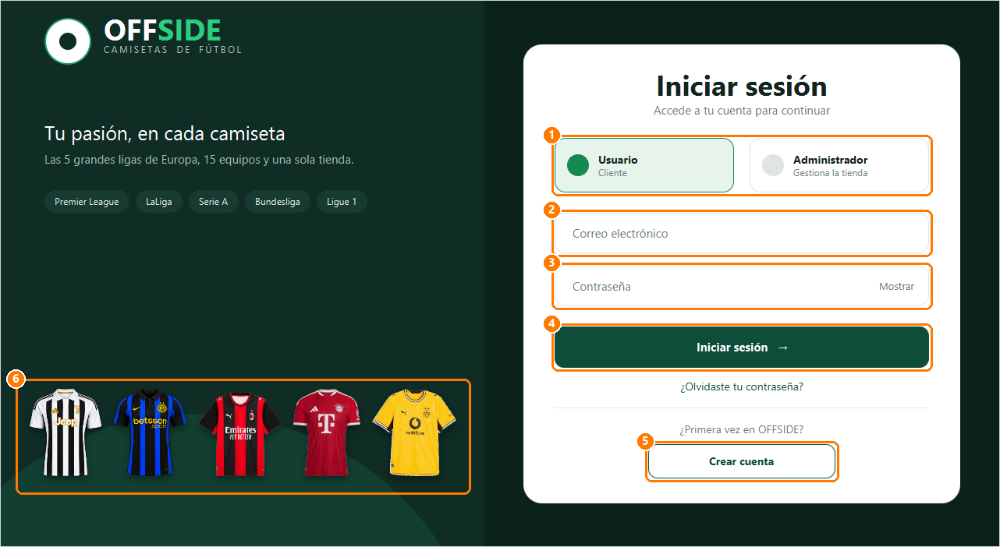

1. **Tipo de cuenta:** elige **Usuario** (cliente) o **Administrador**. Tiene que coincidir con el tipo de tu cuenta; si no, el inicio de sesión falla.
2. **Correo electrónico** con el que te registraste.
3. **Contraseña.** El botón **Mostrar** deja ver lo que escribiste.
4. **Iniciar sesión.** También puedes pulsar `Enter`.
5. **Crear cuenta:** abre el formulario de registro.
6. Las camisetas del panel izquierdo **cambian solas cada pocos segundos** con los productos de la tienda. El administrador puede cambiar ese intervalo en Configuración.

Si el correo, la contraseña o el tipo de cuenta no son correctos, aparece un aviso en rojo:

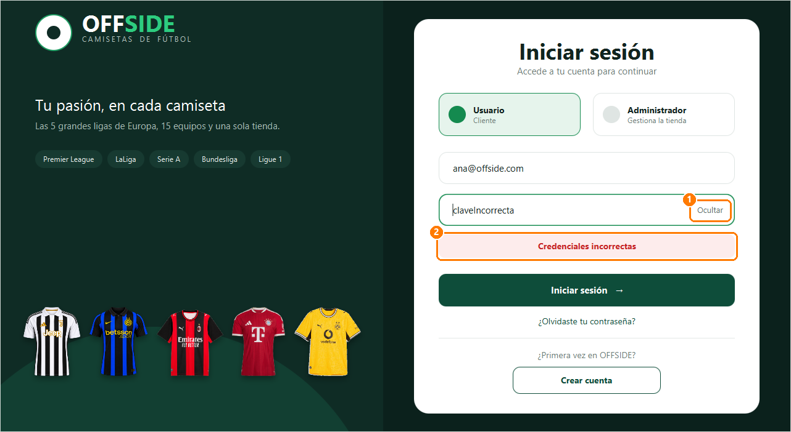

1. **Mostrar / Ocultar:** comprueba que escribiste bien la contraseña.
2. **Aviso "Credenciales incorrectas":** revisa el correo, la contraseña y que el tipo de cuenta (Usuario o Administrador) sea el tuyo.

Con credenciales correctas, el **cliente** entra al **catálogo** y el **administrador** al **panel de control**.

### 1.2 Crear una cuenta

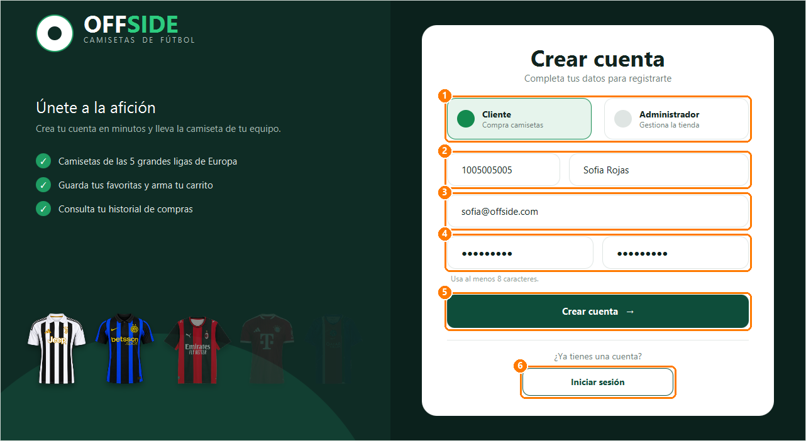

1. **Tipo de cuenta:** Cliente o Administrador.
2. **Identificación** (solo números) y **nombre completo**.
3. **Correo electrónico.** No puede estar registrado antes.
4. **Contraseña y confirmación.** Deben coincidir y tener al menos 8 caracteres.
5. **Crear cuenta:** si los datos son válidos, la cuenta se guarda y vuelves al inicio de sesión.
6. **Iniciar sesión:** vuelve a la pantalla anterior sin registrarte.

Si falta un dato o hay un error, una ventana te dice qué corregir. Por ejemplo: "Ya existe un usuario con este correo" o "Las contraseñas no coinciden".

---

## 2. Cliente

### 2.1 Catálogo y filtros

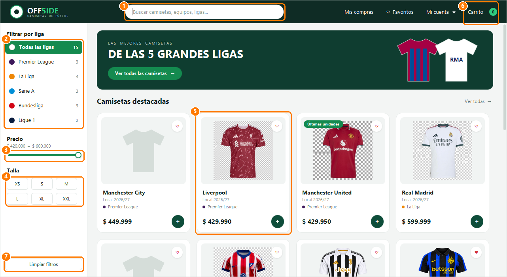

1. **Buscador:** filtra por nombre, equipo o liga mientras escribes. Si estás en otra pantalla (detalle, carrito…), al escribir vuelves al catálogo.
2. **Filtrar por liga:** al lado de cada liga se ve cuántas camisetas tiene.
3. **Precio:** mueve el control para ver solo camisetas hasta ese precio.
4. **Talla:** muestra solo las camisetas disponibles en la talla elegida. Vuelve a pulsarla para quitar el filtro.
5. **Card de una camiseta:** haz clic en cualquier parte del card para abrir su detalle.
6. **Carrito:** el número verde es la cantidad de camisetas que tienes en el carrito.
7. **Limpiar filtros:** vuelve a mostrar todo el catálogo. "Ver todas" y el botón del banner hacen lo mismo.

En la barra superior también están **Mis compras**, **Favoritos** y **Mi cuenta**.

Los filtros se pueden combinar. El título cambia para indicar cuántas camisetas cumplen los filtros:

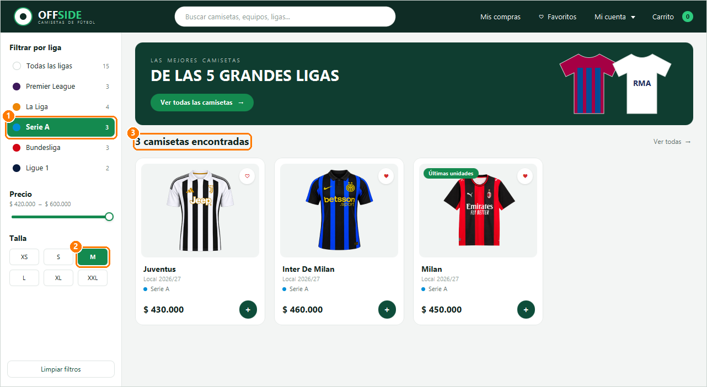

1. Liga **Serie A** seleccionada.
2. Talla **M** seleccionada.
3. **Resultado:** "N camisetas encontradas". Si ninguna cumple los filtros, aparece un mensaje.

**Acciones rápidas desde un card:**

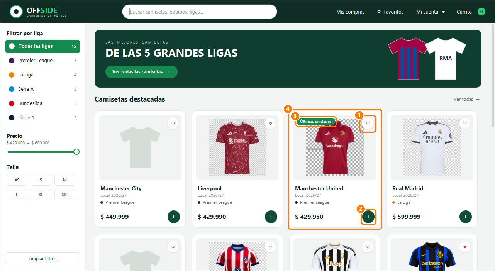

1. **♡ Favorito:** agrega la camiseta a tu lista de deseos (el corazón se llena: ♥). Pulsa otra vez para quitarla.
2. **＋ Agregar al carrito:** agrega 1 unidad en talla **M** (o en la primera talla disponible). Un aviso en la parte inferior confirma la acción.
3. **Etiqueta de stock:** "Últimas unidades" cuando quedan pocas o "Agotado" cuando no hay. Las camisetas agotadas no se pueden agregar.
4. El resto del card abre el **detalle** de la camiseta.

### 2.2 Detalle de una camiseta

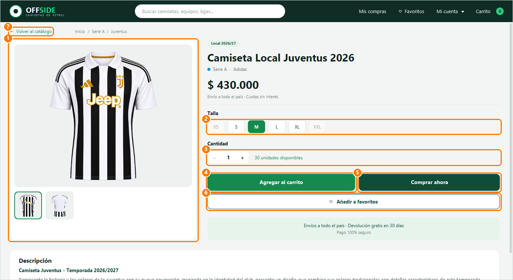

1. **Galería:** si la camiseta tiene varias imágenes, haz clic en una miniatura para verla en grande.
2. **Talla:** las tallas que no existen para esa camiseta aparecen deshabilitadas.
3. **Cantidad:** con **−** y **＋**, sin pasar de las unidades disponibles.
4. **Agregar al carrito:** agrega la talla y la cantidad elegidas.
5. **Comprar ahora:** agrega al carrito y te lleva directo a él.
6. **Añadir a favoritos:** el texto cambia a "♥ En tu lista de deseos". Pulsa otra vez para quitarla.
7. **Volver al catálogo:** vuelves con los filtros que tenías. La ruta "Inicio / Liga / Equipo" también funciona.

Más abajo está la **descripción completa** de la camiseta:

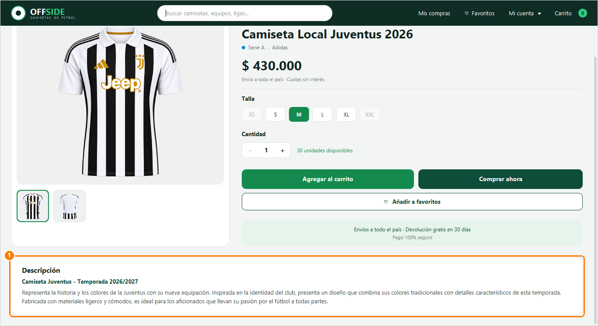

1. Descripción de la camiseta y de la temporada.

### 2.3 Mi lista de deseos (Favoritos)

Ábrela con **♡ Favoritos** en la barra superior.

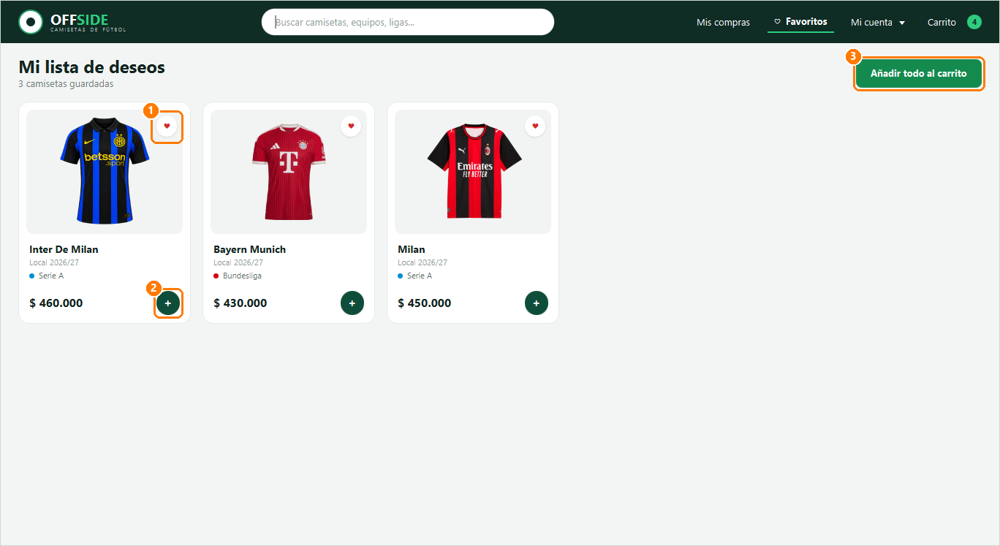

1. **♥:** quita la camiseta de la lista.
2. **＋:** agrega una unidad al carrito (talla M o la primera disponible).
3. **Añadir todo al carrito:** agrega una unidad de cada favorito que tenga stock.

Haz clic en un card para ver su detalle.

### 2.4 Carrito de compras

Ábrelo con **Carrito** en la barra superior.

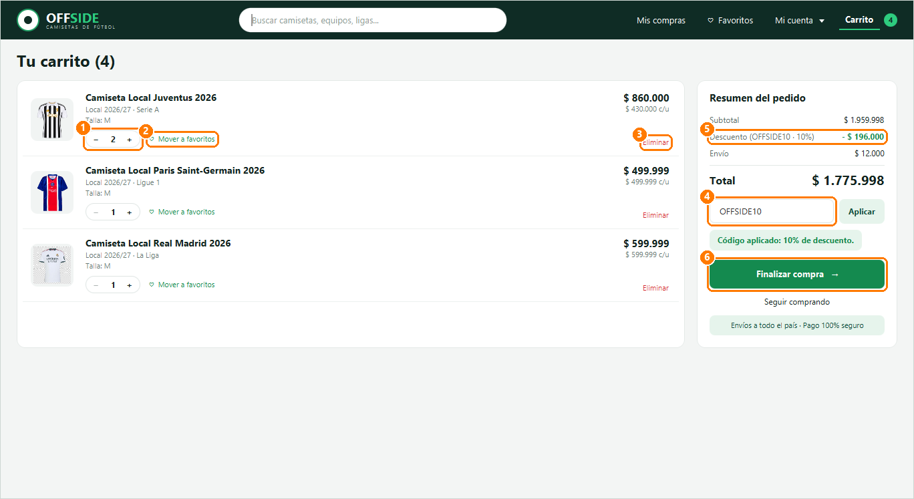

1. **Cantidad:** cambia las unidades de cada línea. No deja pasar del stock disponible, sumando todas las tallas de esa camiseta.
2. **Mover a favoritos:** quita la línea del carrito y deja la camiseta en tu lista de deseos.
3. **Eliminar:** quita la línea del carrito.
4. **Código de descuento:** escríbelo y pulsa **Aplicar**. Solo funcionan los códigos activos que creó el administrador.
5. **Descuento aplicado:** muestra el código, el porcentaje y cuánto ahorras. El descuento es sobre el subtotal de las camisetas; el envío no tiene descuento.
6. **Finalizar compra:** pide confirmación y realiza la compra.

El **envío** lo define el administrador. Si es gratis, el resumen muestra "Gratis".

Antes de comprar, la aplicación pide confirmar el total:

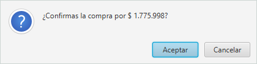

Al aceptar:

- Se descuenta el stock de cada camiseta.
- El carrito se vacía.
- Pasas a **Mis compras**, donde aparece el nuevo pedido.

Si alguna camiseta ya no tiene stock suficiente o el código de descuento se desactivó, **no se compra nada** y se muestra qué pasó.

### 2.5 Mis compras

Ábrelo con **Mis compras** en la barra superior.

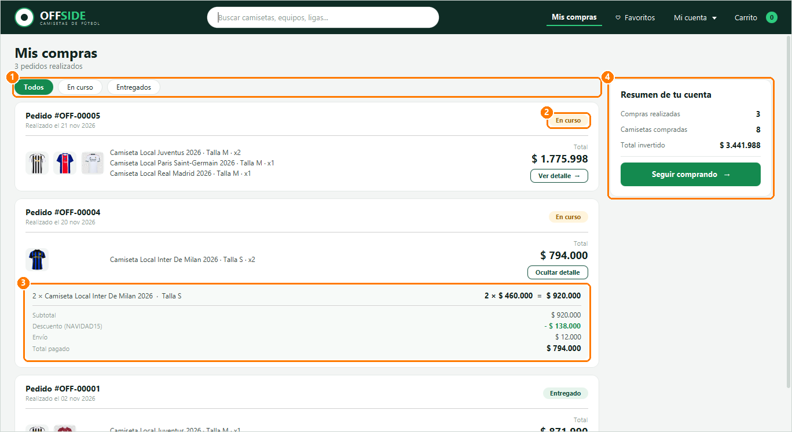

1. **Filtros por estado:** Todos, En curso o Entregados. Un pedido está **En curso** durante los primeros 3 días y después pasa a **Entregado**.
2. **Estado** del pedido.
3. **Ver detalle:** muestra el precio de cada camiseta y el desglose: subtotal, descuento, envío y **total pagado**.
4. **Resumen de tu cuenta:** compras realizadas, camisetas compradas y total invertido.

### 2.6 Mi cuenta

Ábrela desde el menú **Mi cuenta → Mi perfil** de la barra superior.

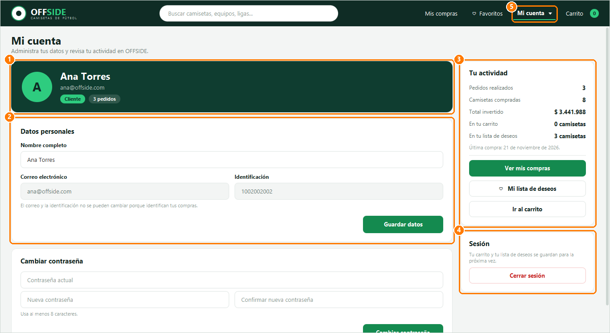

1. **Perfil:** tu nombre, correo y número de pedidos.
2. **Datos personales:** puedes cambiar tu **nombre**. El correo y la identificación no se pueden cambiar porque identifican tus compras.
3. **Tu actividad:** pedidos, camisetas, total invertido, carrito y lista de deseos, con accesos directos a cada sección.
4. **Cerrar sesión.** Tu carrito y tu lista de deseos se guardan para la próxima vez.
5. **Menú Mi cuenta:** tiene **Mi perfil** y **Cerrar sesión**.

Más abajo puedes **cambiar tu contraseña**:

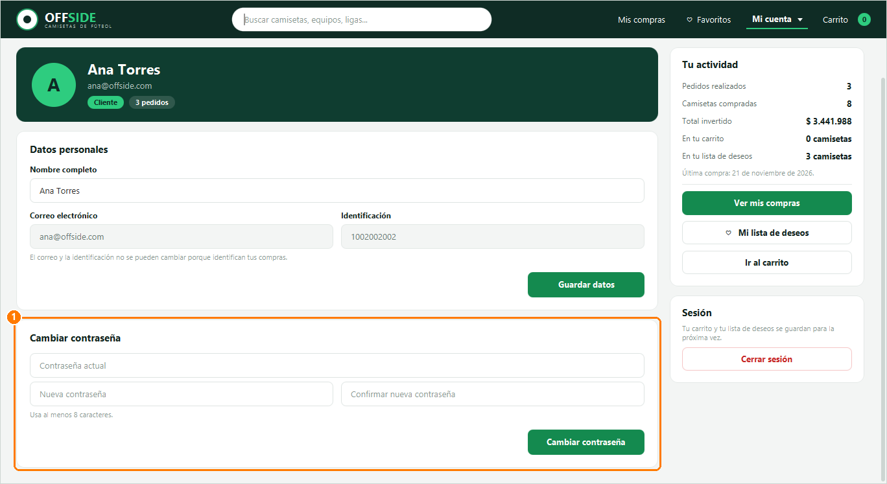

1. Escribe tu contraseña **actual** y la **nueva** dos veces (mínimo 8 caracteres).

---

## 3. Administrador

El administrador tiene un **menú lateral** fijo con seis opciones: **Panel de control**, **Inventario**, **Pedidos**, **Usuarios**, **Reportes** y **Configuración**. Los **productos eliminados** se abren desde el inventario. En la barra superior se ve su nombre y el botón **Cerrar sesión**.

### 3.1 Panel de control

Es lo primero que ve el administrador al entrar.

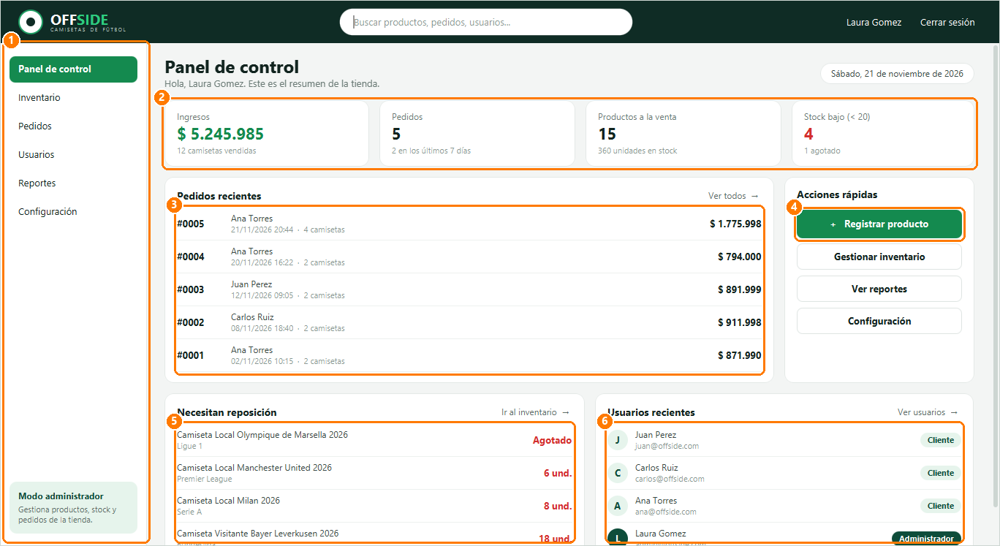

1. **Menú lateral:** la opción en verde es la sección actual.
2. **Indicadores:** ingresos, pedidos (y cuántos en los últimos 7 días), productos a la venta y productos con stock bajo.
3. **Pedidos recientes:** los últimos 5. "Ver todos" abre Pedidos.
4. **Acciones rápidas:** registrar producto, gestionar inventario, ver reportes y configuración.
5. **Necesitan reposición:** productos con menos stock que el umbral de stock bajo.
6. **Usuarios recientes:** las últimas cuentas registradas.

### 3.2 Inventario

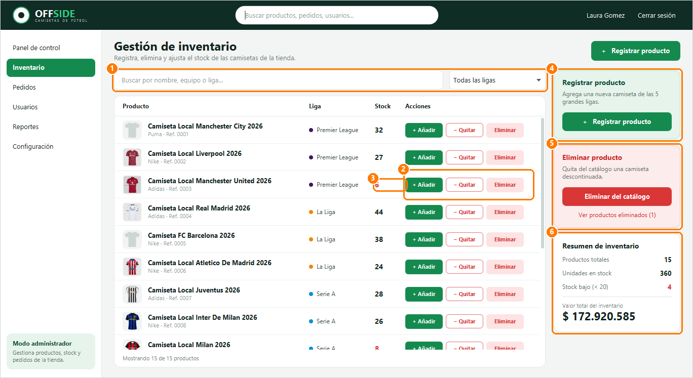

1. **Buscar y filtrar** productos por nombre o liga.
2. **Acciones de cada producto:**
   - **＋ Añadir:** suma unidades al stock.
   - **− Quitar:** resta unidades.
   - **Eliminar:** quita el producto del catálogo.
3. **Stock:** aparece en **rojo** cuando es menor que el umbral de stock bajo.
4. **Registrar producto:** abre el formulario para crear una camiseta.
5. **Eliminar producto:** elige de una lista la camiseta que quieres quitar. El enlace **Ver productos eliminados (N)** abre la lista para restaurarlas.
6. **Resumen de inventario:** productos, unidades, stock bajo y valor total del inventario.

Al pulsar **＋ Añadir** o **− Quitar**, la aplicación pregunta cuántas unidades:

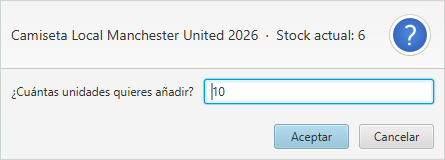

Escribe un número entero mayor que 0. No se pueden quitar más unidades de las que hay. El cambio se guarda de inmediato.

Al pulsar **Eliminar**, la aplicación pide confirmación:

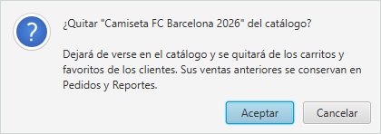

Al eliminar una camiseta:

- **Deja de verse** en el catálogo, en el inventario y en el login.
- **Se quita** de los carritos y favoritos de los clientes.
- **Sus ventas anteriores se conservan** en Pedidos y Reportes.
- **Se puede restaurar** en cualquier momento.

### 3.3 Registrar un producto

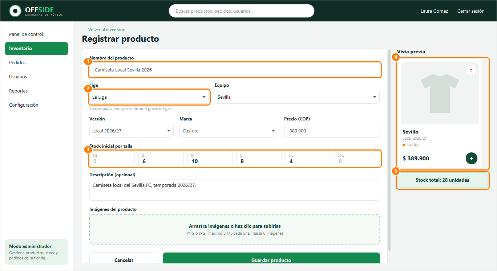

1. **Nombre del producto:** se sugiere solo al elegir el equipo y la versión (por ejemplo, "Camiseta Local Sevilla 2026), pero puedes cambiarlo.
2. **Liga y equipo:** al elegir la liga se cargan sus equipos principales. También eliges la **versión** (Local, Visitante o Tercera), la **marca** y el **precio**.
3. **Stock inicial por talla:** escribe las unidades de cada talla. Se guardan como tallas disponibles las que tienen al menos una unidad.
4. **Vista previa:** muestra cómo se verá el card en el catálogo mientras escribes.
5. **Stock total** sumando todas las tallas.

Más abajo están las imágenes y los botones:

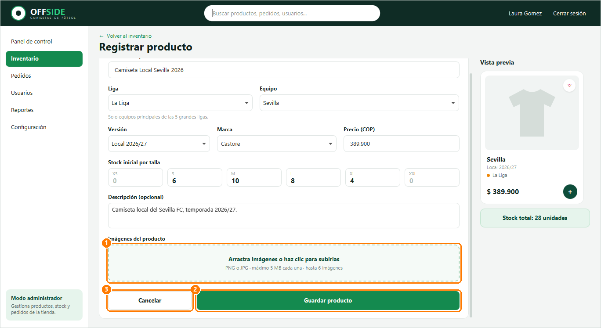

1. **Imágenes:** arrástralas o haz clic para elegirlas. Se aceptan **PNG o JPG** de hasta **5 MB** cada una y **hasta 6** por producto.
   - La **primera** es la **principal** (la que se ve en el catálogo). Haz clic en otra miniatura para hacerla principal.
   - La **×** de cada miniatura la quita.
2. **Guardar producto:** valida los datos, crea el producto y vuelve al inventario.
3. **Cancelar:** vuelve sin guardar.

No se puede registrar un producto si falta el nombre, la liga, el equipo o la marca, si el precio es 0, si no hay stock en ninguna talla o si el nombre ya existe. Si el nombre es el de un producto eliminado, la aplicación sugiere restaurarlo.

### 3.4 Productos eliminados

Ábrelo con **Ver productos eliminados (N)** en el inventario.

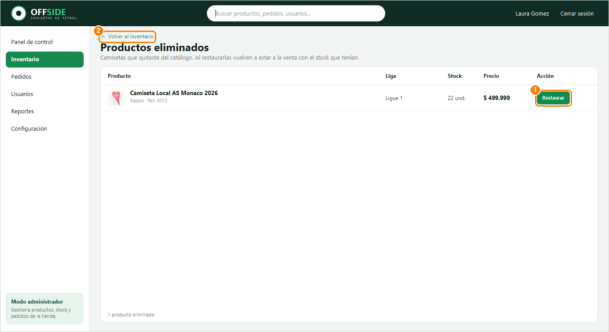

1. **Restaurar:** la camiseta vuelve al catálogo con el stock que tenía.
2. **Volver al inventario.**

### 3.5 Pedidos

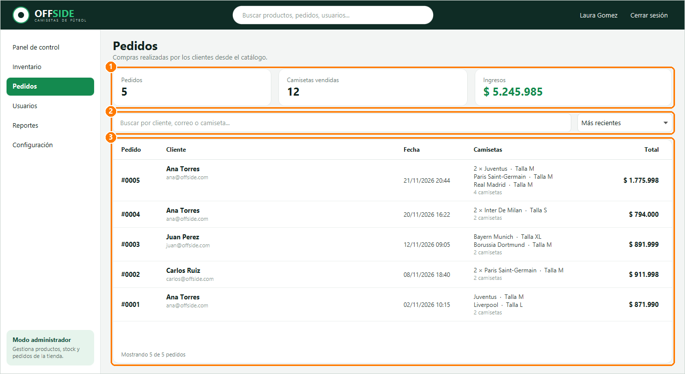

1. **Indicadores:** número de pedidos, camisetas vendidas e ingresos (lo que pagaron los clientes, con descuentos y envíos).
2. **Buscar** por cliente, correo o camiseta, y **ordenar** por más recientes, más antiguos o mayor total.
3. **Tabla de pedidos:** número, cliente, fecha, camisetas (con talla y cantidad) y total. Si el cliente ya no existe, aparece "Usuario eliminado".

### 3.6 Usuarios

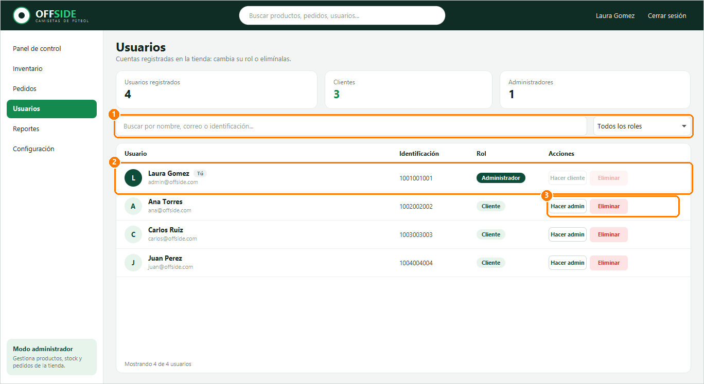

1. **Buscar** por nombre, correo o identificación, y **filtrar** por rol.
2. **Tu propia cuenta** aparece marcada con "Tú" y no se puede cambiar ni eliminar desde aquí. Tampoco se puede quitar el rol ni eliminar al **último administrador**.
3. **Acciones:**
   - **Hacer admin / Hacer cliente:** cambia el rol.
   - **Eliminar:** borra la cuenta.

   Las dos piden confirmación.

### 3.7 Reportes

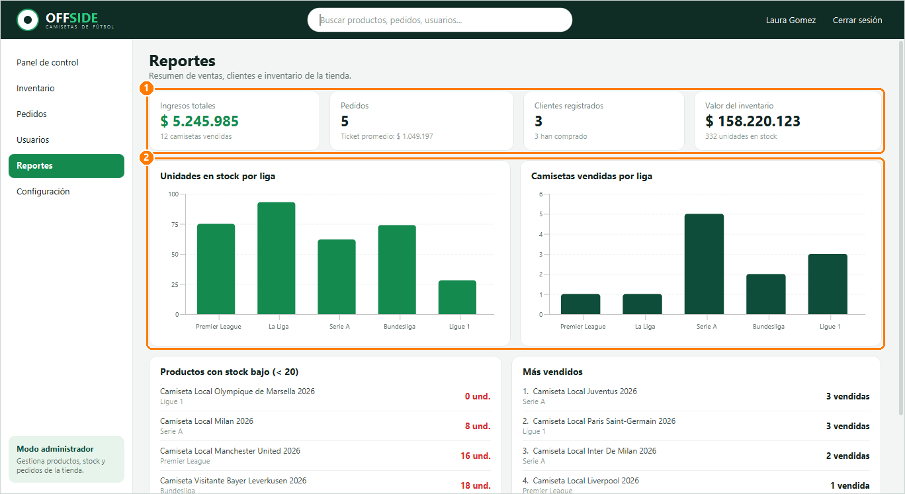

1. **Indicadores:** ingresos, pedidos y ticket promedio, clientes y cuántos han comprado, y valor del inventario.
2. **Gráficas por liga:** unidades en stock y camisetas vendidas.

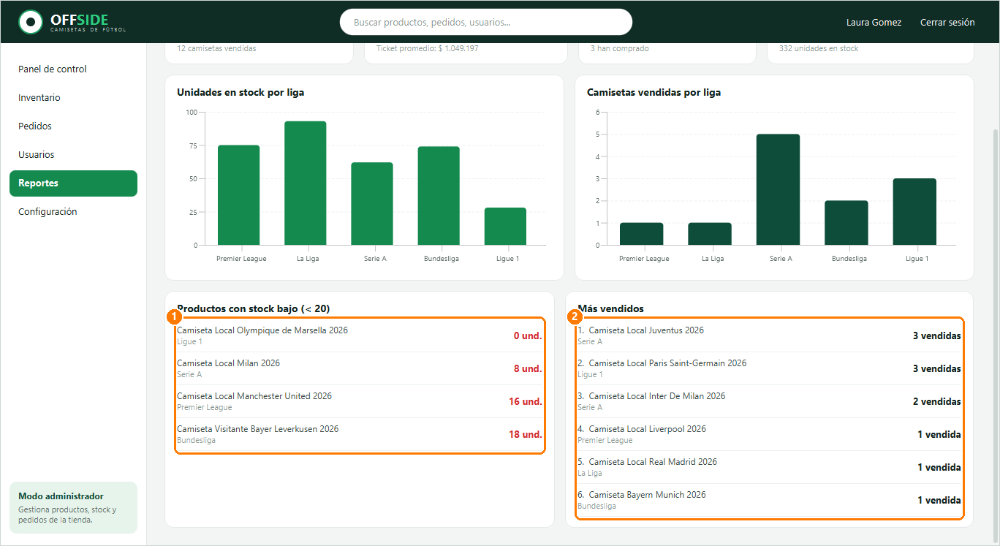

1. **Productos con stock bajo,** del que menos tiene al que más.
2. **Más vendidos,** con las unidades vendidas de cada uno.

### 3.8 Configuración

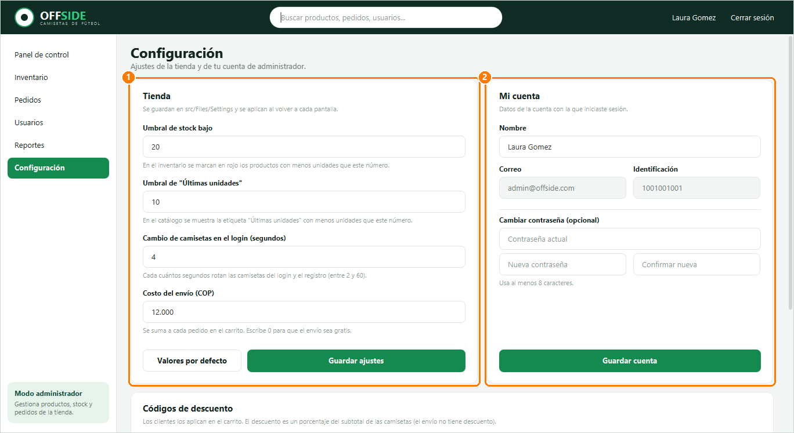

1. **Tienda:**
   - **Umbral de stock bajo:** debajo de este número, el stock se ve en rojo en el inventario y cuenta como "stock bajo".
   - **Umbral de "Últimas unidades":** debajo de este número, el catálogo muestra esa etiqueta.
   - **Cambio de camisetas en el login:** segundos entre cada cambio, de 2 a 60.
   - **Costo del envío (COP):** se suma a cada pedido. Con **0**, el envío es gratis.

   **Valores por defecto** restablece 20, 10, 4 y $ 12.000.
2. **Mi cuenta:** cambia tu nombre y tu contraseña (pide la actual).

Más abajo están los **códigos de descuento**:

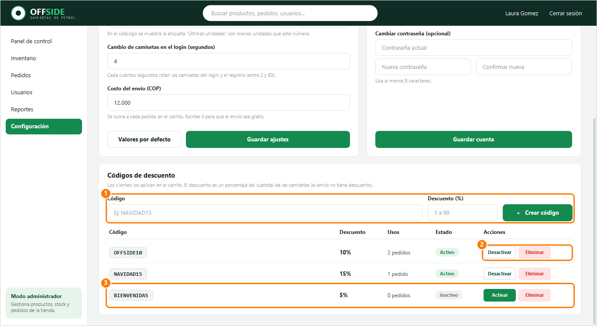

1. **Crear código:** escribe el código (de 3 a 20 letras o números, sin espacios) y el porcentaje de descuento (de 1 a 90).
2. **Activar / Desactivar** un código, o **eliminarlo**. Los clientes solo pueden usar los códigos activos.
3. Cada código muestra su **porcentaje**, cuántos **pedidos** lo usaron y su **estado**. Eliminar un código no cambia los pedidos que ya lo usaron.

---

## 4. Preguntas frecuentes

**No puedo iniciar sesión aunque la contraseña es correcta.**
Revisa que el tipo de cuenta (Usuario o Administrador) sea el de tu cuenta.

**Una camiseta no se puede agregar al carrito.**
Está agotada o ya tienes en el carrito todas las unidades disponibles, sumando todas las tallas.

**Mi código de descuento dice "no es válido".**
El código no existe o el administrador lo desactivó.

**Una camiseta se ve gris, sin foto.**
El producto no tiene imagen, o su imagen está en un formato que la aplicación no puede leer (por ejemplo, WebP). El administrador debe reemplazarla por una imagen PNG o JPG.

**Eliminé un producto por error.**
En Inventario pulsa **Ver productos eliminados** y luego **Restaurar**.

---

# Manual para desarrolladores

## 1. Requisitos y ejecución

| Requisito | Detalle |
|---|---|
| Java | **JDK 8** con JavaFX incluido (por ejemplo, Oracle JDK 1.8, que trae `jfxrt.jar`). El proyecto compila con `javac.source=1.8`. |
| IDE | **NetBeans** (proyecto Ant con `build.xml` y `nbproject/`). Se puede compilar sin IDE. |
| Clase principal | `Main.App` (`javafx.main.class` en `nbproject/project.properties`). `Main.Main` también la lanza. |
| Directorio de trabajo | **La carpeta del proyecto.** Los datos se leen de `src/Files` y las imágenes de `src/Images` usando `System.getProperty("user.dir")`. |
| Editor visual | Scene Builder para los `.fxml` (opcional). |

**En NetBeans:** abre el proyecto y ejecútalo con *Run Project* (F6). NetBeans usa la carpeta del proyecto como directorio de trabajo.

**Sin IDE (Git Bash, con el JDK 8 en el PATH):**

```bash
mkdir -p build/classes
javac -encoding UTF-8 -d build/classes $(find src -name "*.java")
cp -r src/Views src/Styles src/Images build/classes/
java -cp build/classes Main.App
```

Ejecuta `java` desde la raíz del proyecto para que encuentre `src/Files` y `src/Images`.

## 2. Estructura del proyecto

```
src/
├── Main/                     Punto de entrada (App, Main)
├── Models/                   Modelos de datos
│   ├── User, Admin, Client       Usuarios (Admin y Client extienden User)
│   ├── Product                   Camiseta (también línea de carrito/favorito/historial)
│   ├── Order                     Pedido (agrupa líneas del historial)
│   ├── Discount_Code             Código de descuento
│   └── Nodes/Node_User, Node_Product   Nodos de las estructuras enlazadas
├── DataStructures/           Estructuras de datos y acceso a archivos
│   ├── Data_Manager              Singleton con todas las instancias compartidas
│   ├── List_Double_User          Lista doblemente enlazada de usuarios
│   ├── Stack_Of_Product          Pilas de carrito, favoritos e historial + catálogo
│   ├── App_Settings              Ajustes de la tienda (archivo Settings)
│   └── Discount_Codes            Códigos de descuento (archivo DiscountCodes)
├── Controllers/              Controladores de las vistas (uno por FXML)
│   ├── Catalog_Navigator         Interfaz que usan las vistas del cliente
│   └── ComponentsControllers/    Controladores de los componentes reutilizables
├── Views/                    Vistas FXML
│   └── Components/               Componentes (cards, filas, detalle)
├── Styles/                   Hojas de estilo
│   ├── Style_sheet.css           Estilos generales de todas las vistas
│   └── StyleSheetsComponents/    Un CSS por componente
├── Utilities/                Ayudantes (imágenes de productos, carrusel del login)
├── Files/                    Datos de la aplicación (texto plano)
└── Images/ProductImages/     Imágenes de los productos
docs/images/                  Capturas usadas en este README
```

## 3. Arquitectura

La aplicación sigue un esquema **MVC**:

- **Vista:** archivos FXML con su CSS.
- **Controlador:** clases `Controller_view_*` y `*_ComponentController`.
- **Modelo y datos:** `Models` y `DataStructures`. Los datos se guardan en archivos de texto.

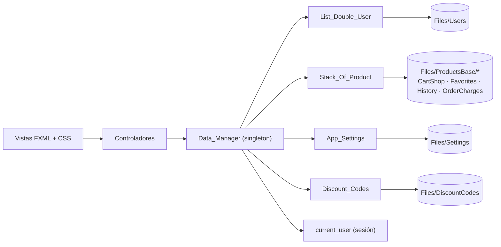

### 3.1 `Data_Manager`

Es un **singleton** (`Data_Manager.getManager()`) que reúne las instancias que comparten todas las pantallas:

| Método | Devuelve | Uso |
|---|---|---|
| `getList_user()` | `List_Double_User` | Usuarios. Se cargan al iniciar en `App.start()`. |
| `getStacks_products()` | `Stack_Of_Product` | Catálogo, carrito, favoritos, historial y pedidos. |
| `getSettings()` | `App_Settings` | Umbrales de stock, intervalo del carrusel y costo del envío. |
| `getDiscount_codes()` | `Discount_Codes` | Códigos de descuento. |
| `getCurrent_user()` / `setCurrent_user()` | `Node_User` | Sesión actual. Se asigna al iniciar sesión y se limpia al cerrarla. |

### 3.2 Estructuras principales

- **`List_Double_User`:** lista doblemente enlazada de `Node_User`. Tiene métodos para buscar por correo (`search_email`), validar credenciales, crear, eliminar (`remove_user`) y cambiar el rol (`change_role`), y para guardar y cargar el archivo `Users`.
- **`Stack_Of_Product`:**
  - **Pilas:** tres `java.util.Stack<Product>` (carrito, favoritos e historial), cada una con su archivo.
  - **Catálogo:** `loadProductFromCatalog`, `loadActiveCatalog`, `saveProductToCatalog`, `updateStockInCatalog`, `discontinueProduct` y `restoreProduct`.
  - **Cliente:** `addItemToCart`, `updateCartItemQuantity`, `removeCartItem`, `toggleFavorite` y `checkout`. `checkout` valida el stock, lo descuenta, pasa el carrito al historial y guarda el descuento y el envío del pedido.
  - **Pedidos:** `groupHistoryIntoOrders` agrupa el historial en pedidos (`Order`) por correo y fecha (con segundos), y les suma los cargos de `OrderCharges`.

### 3.3 Navegación

- **Entre pantallas completas** (login, registro, catálogo, panel del administrador) se reemplaza la raíz de la escena:

  ```java
  Parent vista = FXMLLoader.load(getClass().getResource("/Views/View_catalog.fxml"));
  boton.getScene().setRoot(vista);
  ```

- **Dentro del panel del administrador**, `Controller_view_admin` cambia solo el **centro** del `BorderPane` (`paneRaiz.setCenter(...)`). Así la barra superior y el menú lateral se mantienen. Cada sección es un FXML independiente (`View_admin_*.fxml`).
- **Dentro del catálogo**, `Controller_view_catalog` oculta los filtros y pone en el centro el detalle, el carrito, los favoritos, Mis compras o Mi cuenta. Esas vistas se comunican con el catálogo mediante la interfaz **`Catalog_Navigator`** (`volverAlCatalogo`, `abrirProducto`, `abrirCarrito`, `agregarAlCarrito`, `actualizarContadorCarrito`, `mostrarAviso`, etc.).

### 3.4 Componentes

Los elementos que se repiten son componentes FXML con su propio controlador y CSS. Se cargan con `FXMLLoader` y se llenan con un método `set…`:

```java
FXMLLoader loader = new FXMLLoader(getClass().getResource("/Views/Components/Product_Component.fxml"));
Parent card = loader.load();
Product_ComponentController controlador = loader.getController();
controlador.setProducto(producto);
controlador.setAlSeleccionar(this::abrirDetalle);   // callback hacia la vista que lo contiene
```

| Componente | Se usa en | Método principal |
|---|---|---|
| `Product_Component` | Catálogo, vista previa del registro | `setProducto(Product)` |
| `Product_Detail_Component` | Detalle en el catálogo | `setProducto(Product)`, `setNavegador(...)` |
| `Admin_Product_Component` | Filas del inventario | `setProducto(Product, int)` |
| `Cart_Item_Component` | Líneas del carrito | `setItem(Product, String, Runnable)` |
| `Favorite_Item_Component` | Lista de deseos | `setProducto(Product, …callbacks)` |

## 4. Archivos de datos

Todos están en `src/Files/` y son texto plano. Los campos se separan con `", "` (coma y espacio), así que **ningún valor puede contener comas**: los formularios lo validan.

| Archivo | Formato de cada línea | Ejemplo |
|---|---|---|
| `Users` | `ROL, nombre, identificación, correo, contraseña` | `CLIENT, Ana Torres, 1002002002, ana@offside.com, Ana2026ok` |
| `CartShop` | `idProducto, correo, NULL, talla, cantidad` | `7, ana@offside.com, NULL, M, 2` |
| `Favorites` | `idProducto, correo, NULL, NULL, 1` | `8, ana@offside.com, NULL, NULL, 1` |
| `History` | `idProducto, correo, dd/MM/yyyy HH:mm:ss, talla, cantidad` | `8, ana@offside.com, 20/11/2026 16:22:41, S, 2` |
| `OrderCharges` | `correo, dd/MM/yyyy HH:mm:ss, descuento, envío, código` | `ana@offside.com, 20/11/2026 16:22:41, 138000, 12000, NAVIDAD15` |
| `DiscountCodes` | `CODIGO, porcentaje, ACTIVO o INACTIVO` | `OFFSIDE10, 10, ACTIVO` |
| `Settings` | `clave=valor` | `costo_envio=12000` |

Notas sobre estos archivos:

- **`Users`:** `ROL` es `ADMIN` o `CLIENT`.
- **Quinto campo de `CartShop`, `Favorites` y `History`:** es la cantidad. Las líneas antiguas sin cantidad se leen como 1, y las fechas antiguas sin segundos también se aceptan.
- **`OrderCharges`:** guarda el descuento y el envío de cada pedido. Se une al historial por correo y fecha, y la línea solo se escribe si el pedido tuvo descuento o envío. Si no hubo código, el último campo es `NULL`.
- **`DiscountCodes`:** si el archivo no existe se usa `OFFSIDE10` al 10%.
- **`Settings`:** las claves son `stock_bajo`, `ultimas_unidades`, `intervalo_carrusel` y `costo_envio`. Las que falten toman su valor por defecto (20, 10, 4 y 12000).

### 4.1 Productos (`src/Files/ProductsBase/`)

Cada producto es un archivo `NNNN - Product Data.txt`. `NNNN` es el id con 4 dígitos: `0001`, `0002`… El siguiente id libre lo da `getNextProductId()`.

```
Nombre: Camiseta Local Real Madrid 2026
Marca: Adidas
Equipo: Real Madrid
Liga: La Liga
Tallas: S, M, L, XL
Precio: $599.999
Stock: 45
Estado: Descontinuado          ← solo si el producto fue eliminado
Descripcion: Camiseta Real Madrid – Temporada 2026/2027

Párrafo con la descripción larga (se muestra en el detalle del producto).
```

- Los archivos se leen en **UTF-8**.
- **Precio:** se aceptan `$599.999` y `599.999$`; los puntos son separadores de miles.
- **Producto eliminado:** no se borra el archivo, se le agrega `Estado: Descontinuado`. Así las compras anteriores siguen apareciendo en Pedidos y Reportes. `restoreProduct` quita esa línea.

### 4.2 Imágenes (`src/Images/ProductImages/`)

- **Nombre:** `NNNN - Equipo - N.png` (o `.jpg`). La imagen `- 1` es la **principal**, la que usan el catálogo, el inventario y el carrusel del login; las demás se ven en la galería del detalle.
- **Formato:** JavaFX 8 **no lee WebP**. Si una imagen no se puede leer, se muestra una camiseta genérica.
- **Carrusel del login:** solo usa imágenes con **fondo transparente** (constante `SOLO_FONDO_TRANSPARENTE` en `Shirt_Carousel`).

## 5. Vistas, controladores y componentes

| Vista (`src/Views`) | Controlador | Descripción |
|---|---|---|
| `View_main.fxml` | `Controller_view_main` | Inicio de sesión |
| `View_register.fxml` | `Controller_view_register` | Registro de cuentas |
| `View_catalog.fxml` | `Controller_view_catalog` | Catálogo del cliente (implementa `Catalog_Navigator`) |
| `View_cart.fxml` | `Controller_view_cart` | Carrito |
| `View_favorites.fxml` | `Controller_view_favorites` | Lista de deseos |
| `View_purchase_history.fxml` | `Controller_view_purchase_history` | Mis compras |
| `View_account.fxml` | `Controller_view_account` | Mi cuenta del cliente |
| `View_admin.fxml` | `Controller_view_admin` | Marco del administrador (barra, menú lateral e inventario) |
| `View_admin_dashboard.fxml` | `Controller_view_admin_dashboard` | Panel de control |
| `View_admin_register_product.fxml` | `Controller_view_admin_register_product` | Registrar producto |
| `View_admin_discontinued.fxml` | `Controller_view_admin_discontinued` | Productos eliminados |
| `View_admin_orders.fxml` | `Controller_view_admin_orders` | Pedidos |
| `View_admin_users.fxml` | `Controller_view_admin_users` | Usuarios |
| `View_admin_reports.fxml` | `Controller_view_admin_reports` | Reportes |
| `View_admin_settings.fxml` | `Controller_view_admin_settings` | Configuración |

**Ayudantes (`src/Utilities`):**

- **`Product_Images`:**
  - `firstImage(id, tamaño)`: carga la imagen principal de un producto.
  - `leagueColorClass(liga)`: devuelve la clase CSS del color de la liga.
  - `versionText(nombre)`: devuelve "Local 2026/27", "Visitante 2026/27" o "Tercera 2026/27".
- **`Shirt_Carousel`:** hace rotar las camisetas del login y el registro. Carga las imágenes en segundo plano y se detiene sola al salir de la pantalla.

## 6. Cómo extender la aplicación

### Agregar un producto sin la interfaz

1. Crea `src/Files/ProductsBase/NNNN - Product Data.txt` con el formato de la sección 4.1, usando el siguiente número libre.
2. Copia sus imágenes a `src/Images/ProductImages/NNNN - Equipo - 1.png`, `- 2.png`…

Lo normal es hacerlo desde **Inventario → Registrar producto**, que valida los datos.

### Agregar equipos a una liga

Edita el mapa `EQUIPOS_POR_LIGA` en `Controller_view_admin_register_product`. Si agregas una liga nueva, agrega también su clase de color (`league-dot-…`) en los CSS y en `Product_Images.leagueColorClass`.

### Agregar una sección al panel del administrador

1. Crea `src/Views/View_admin_nueva.fxml`. Su raíz debe ser un `VBox` o `ScrollPane` con `styleClass="admin-content"`, y debe incluir el `stylesheets` de `Style_sheet.css`.
2. Crea su controlador `Controllers/Controller_view_admin_nueva.java`.
3. En `View_admin.fxml` agrega un botón en el menú lateral, con `styleClass="sidebar-item"`.
4. En `Controller_view_admin.initialize()` conecta el botón:

   ```java
   btnNueva.setOnAction(e -> mostrarSeccion("/Views/View_admin_nueva.fxml", btnNueva));
   ```

   y agrégalo al arreglo de `marcarOpcionActiva` para que se resalte.

### Agregar una vista al cliente

Crea el FXML y su controlador con un método `setNavegador(Catalog_Navigator navegador)`. Después, en `Controller_view_catalog`, carga la vista y llama a `mostrarVista(vista, botonDeLaBarra)`. Si la vista necesita algo nuevo del catálogo, agrégalo a la interfaz `Catalog_Navigator`.

### Agregar un ajuste a Configuración

1. En `App_Settings`, agrega la clave (constante), su valor por defecto en `restoreDefaults()` y su getter y setter.
2. En `View_admin_settings.fxml`, agrega el campo en la tarjeta *Tienda*.
3. En `Controller_view_admin_settings`, muéstralo en `mostrarAjustes()`, y valídalo y guárdalo en `onGuardarTienda()`.

## 7. Convenciones

- **Nombres de `fx:id`** con prefijo según el tipo de control: `btn` (Button), `lbl` (Label), `txt` (TextField), `pwd` (PasswordField), `cb` (ComboBox), `rb` (RadioButton), `tb` (ToggleButton), `tg` (ToggleGroup), `lnk` (Hyperlink), `img` (ImageView), `sp` (ScrollPane), `vb` / `hb` (VBox / HBox), `pane` (otros contenedores), `fp` (FlowPane), `cir` (Circle).
- **Nombres de archivos y clases:**
  - Vistas: `View_*.fxml`.
  - Controladores: `Controller_view_*`.
  - Componentes: `*_Component.fxml` con `*_ComponentController`.
- **Idioma:** variables, métodos y mensajes de la interfaz en español. Las clases de datos (`DataStructures`, `Models`) usan nombres en inglés, como estaban en el proyecto.
- **Estilos:** los colores y clases generales están en `Style_sheet.css`. Cada componente tiene su CSS en `StyleSheetsComponents/`. Verde principal: `#148a4f`; verde oscuro: `#0e4d3a` / `#0f2c25`.
- **Capturas del README:** están en `docs/images/`. Si cambias una pantalla, actualiza su captura.
